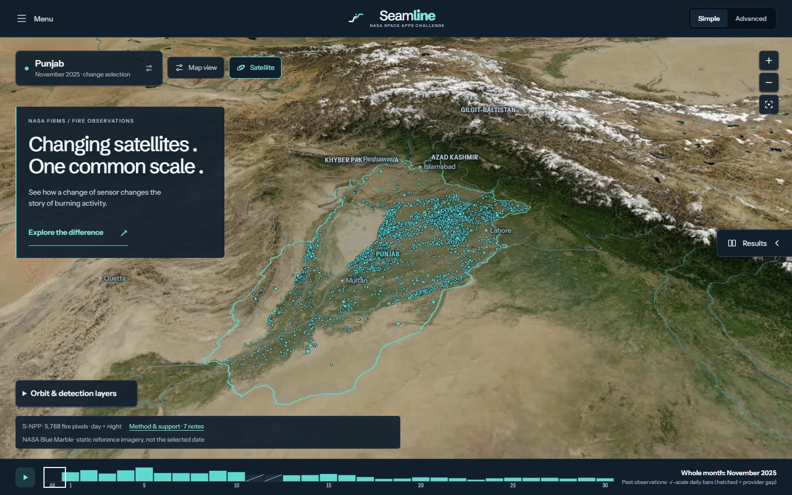
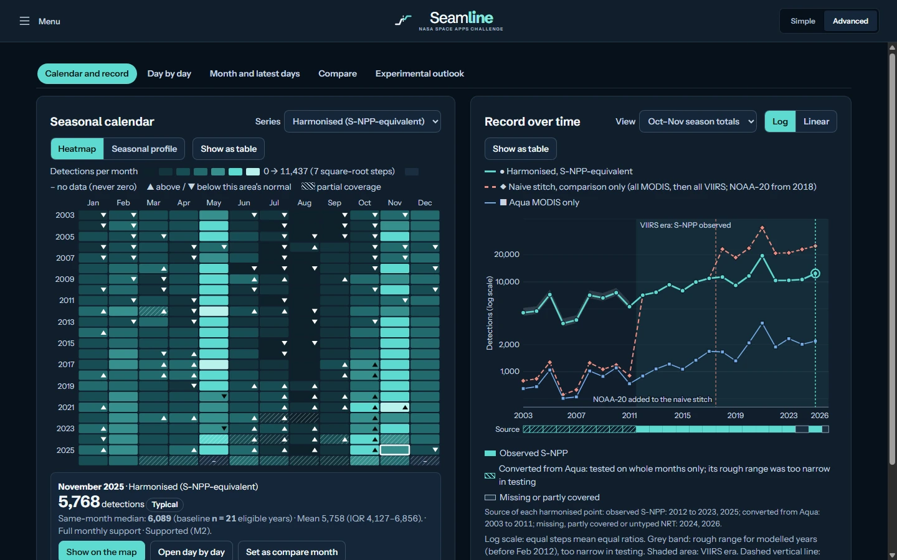

<div align="center">

# Seamline

**A burning activity calendar for Pakistan**

Compare more than two decades of NASA FIRMS satellite observations across the MODIS and VIIRS eras.

[**Launch Seamline**](https://seamline-mu.vercel.app/) · [Methods & evidence](https://seamline-mu.vercel.app/report) · [Run locally](#run-locally)

2026 NASA Space Apps Challenge · C08, Harmonization of MODIS and VIIRS Hot Spots

</div>

[](https://seamline-mu.vercel.app/?intro=0&area=Punjab&day=2025-11&map=3d&basemap=satellite)

*Punjab, November 2025. The turquoise marks are observed Suomi NPP VIIRS detection pixels. The static NASA Blue Marble basemap provides geographic context.*

## Why Seamline exists

MODIS reports active-fire pixels at a nominal 1 km resolution. VIIRS reports them at 375 m. As pixel sizes, overpass times, and the mix of satellites change, a long record can show a jump in detections that is hard to interpret.

Seamline uses overlapping Aqua MODIS and Suomi NPP VIIRS observations to calibrate the monthly record onto a common detection scale. The app keeps the original observations available alongside modeled values and flags incomplete or missing months so each comparison can be traced back to its source.

## Explore the app

| View | What you can do |
| --- | --- |
| [3D satellite map](https://seamline-mu.vercel.app/?intro=0&area=Punjab&day=2025-11&map=3d&basemap=satellite) | Select a province or draw an area. Filter by instrument, day, or day/night pass and inspect the underlying detections. |
| [Calendar & comparison](https://seamline-mu.vercel.app/?intro=0&area=Punjab&day=2025-11&ws=calendar&experience=advanced) | Scan seasonal patterns, switch between raw and harmonized counts, and open the daily record for a selected month. |
| [Evidence & methods](https://seamline-mu.vercel.app/?intro=0&ws=evidence&experience=advanced) | Review the saved evaluations, explore the handover replay, and check which observations support the comparison. |

Export monthly values, detection records, and their provenance for further analysis.

[](https://seamline-mu.vercel.app/?intro=0&area=Punjab&day=2025-11&ws=calendar&experience=advanced)

## What the evidence shows

For October–November in Punjab, the average later-to-earlier detection ratio (2012–2021 versus 2003–2011) was **16.8×** in the raw joined record and **1.87×** after harmonization. The ratio describes the recorded detection pixels. Measuring fires or burned area requires different evidence. [Saved Punjab comparison](experiments/E02_evaluation/result.json)

The default model M2 estimates separate conversion factors for each month of the year and for day and night passes. It uses observed Suomi NPP values where the record supports them and labels modeled months separately. [Calibration protocol](experiments/PROTOCOL_P01.md)

| Punjab evaluation | Default model M2 | Simpler ratio M1 |
| --- | ---: | ---: |
| [Leave-one-year-out model selection](experiments/E01_selection/result.json), 47 months | **13.0%** | 20.8% |
| [Separate holdout](experiments/E02_evaluation/result.json), 22 months | 23.1% | **17.5%** |

These figures are weighted absolute percentage errors for agreement with another satellite record. Lower is better. The nominal 80% ranges covered about **59%** of holdout months, so the app presents them as rough ranges. The tested NOAA-20 bridge applies only to compatible Punjab observations. Daily conversion remains experimental, and the outlook displays **Forecast unavailable**.

## Run locally

Use **Python 3.13** to match the repository’s [runtime version](.python-version). From the root of a local clone, create a virtual environment and start Flask. The cached inputs ship with the repository and support ordinary app startup without an API key.

```powershell
# Windows PowerShell
py -3.13 -m venv .venv
.\.venv\Scripts\python.exe -m pip install -r requirements.lock.txt
.\.venv\Scripts\python.exe -m c08.app
```

```bash
# macOS or Linux
python3.13 -m venv .venv
.venv/bin/python -m pip install -r requirements.lock.txt
.venv/bin/python -m c08.app
```

Open [localhost:8766](http://127.0.0.1:8766/). Use the Flask development server for local review.

<details>
<summary>Run the Docker image</summary>

```bash
docker build -t seamline .
docker run --rm -p 8080:8080 seamline
```

Open [localhost:8080](http://127.0.0.1:8080/). The container recipe runs Gunicorn as a non-root user and serves file-backed Parquet and CSV data. The [health route](http://127.0.0.1:8080/healthz) reports readiness after initialization. Begin with one worker and measure memory and startup time on your host.

</details>

## Repository guide

| Path | Purpose |
| --- | --- |
| [`c08/web/`](c08/web/) | JavaScript interface, MapLibre maps, charts, and local assets |
| [`c08/`](c08/) | Flask routes, analysis, current-record adapter, and exports |
| [`data/`](data/) and [`research/metadata/`](research/metadata/) | Cached detections, boundaries, coverage, and provider missing-date records |
| [`experiments/`](experiments/) and [`reports/c08/`](reports/c08/) | Frozen protocols, saved evaluations, and methods reports |
| [`wsgi.py`](wsgi.py), [`vercel.json`](vercel.json), and [`Dockerfile`](Dockerfile) | Production entry point and deployment configuration |

Before pushing, fetch the latest `main` and use a regular fast-forward update to preserve teammate changes. Vercel production tracks `main`. Preserve the frozen historical inputs and evaluation outputs, and keep source, partial-period, and support labels attached to the data. Deployment uses the saved evidence.

## Team, sources & credits

| Team member | Role |
| --- | --- |
| **Muhammad Hasnain Memon** | Leader |
| **Akbar Hussain** | UI/UX and 3D animation |
| **Mughees Khan** | Backend |

[NASA FIRMS](https://www.earthdata.nasa.gov/data/tools/firms) provides the MODIS and VIIRS observations. [RESOURCES.json](RESOURCES.json) lists data and asset sources. [AI_USAGE.json](AI_USAGE.json) records AI assistance. This public deployment imports a pre-event research prototype. Its [original provenance record](https://github.com/HasnainMemon04/_seamline_/blob/d1c4bc2bcd3a594b497e799607f2c12fa0f70db8/PROVENANCE.json) is preserved in Git history.

Original project source is licensed under [Apache 2.0](LICENSE). Data, fonts, and vendor assets retain their own terms, detailed in [NOTICE](NOTICE).
